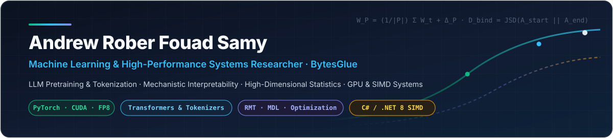

  

   

  
  
  
  

---

### Research Overview

I design **mathematically grounded machine learning algorithms** and **bare-metal GPU / SIMD systems**—focusing on structural bottlenecks in **LLM pretraining & tokenization**, **mechanistic interpretability**, **non-asymptotic high-dimensional statistics**, and **stochastic optimization**. Every research release pairs closed-form theoretical guarantees with reproducible from-scratch PyTorch/CUDA and vectorized `.NET` implementations.

---

### Selected Research Papers & Open-Source Implementations

| Research Monograph & Codebase | Core Mathematical & Empirical Contributions | Artifacts |
| :--- | :--- | :---: |
| **[MechanisticPhraseTokenization](https://github.com/AndrewRober/MechanisticPhraseTokenization)** *What Earns a Phrase Its Own Token?* | **34 from-scratch pretrained Transformers (`30.4M` $\to$ `149.6M` zero-shot transfer)** isolating superword vocabulary allocation. • **33%–37% Slot-Waste Audit** of iterative `SuperBPE` & `SupraTok` • **Prefix-Cone Decoding** (`+0.80%` to `+1.59%` next-word recovery with `0` retraining) • **Foldable Compositional-Residual Superwords** ($W_P = \bar{W}_t + \Delta_P$, `0.0` float folding error, `#1` OOD `BPB`, unsupervised idiom detection) • **Attention-Query De-Multiplexing ($D_{\text{bind}}$) & Compute Gearshifting** (`-51.2%` Layer-2 stitching; `86.81%` `BLiMP` & `+1.58%` CoT-free test-time scaling at `150M`) |    |
| **[KurtosisScaleCorrection](https://github.com/AndrewRober/KurtosisScaleCorrection)** *Beyond Bessel's Correction & Empirical-Bayes GRPO* | Power-scale concavity–convexity Jensen duality, **Kurtosis-Optimal Scale Shrinkage (KPS)** for heavy-tailed distributions, and **Empirical-Bayes Advantage Normalization for GRPO** LLM reinforcement learning (`PyTorch CUDA` + `C#/.NET 8` + `NVIDIA GB10` LLM benchmarks). |  |
| **[IntrinsicDimKMeans](https://github.com/AndrewRober/IntrinsicDimKMeans)** *Spectral Intrinsic-Dimension MDL K-Means* | **Zero-hyperparameter cluster count ($K^*$) discovery** via Random Matrix Theory (Marchenko–Pastur bulk edge) and Minimum Description Length on the active spectral manifold—overcoming high-D Transformer embedding collapse and Voronoi overfitting (`Python` & `C#/.NET`). |  |
| **[HigherDimensionalEWMABiasCorrection](https://github.com/AndrewRober/HigherDimensionalEWMABiasCorrection)** *Non-Stationary High-D EWMA & AdaTCAdamW* | Exact non-stationary drift bias elimination in higher-dimensional exponential moving averages, $O(1/d)$ blessing-of-dimensionality variance bounds, `PyTorch` **AdaTCAdamW** optimizer, and hardware-accelerated `C#/.NET` SIMD vector engine. |  |

---

### Featured Result: Mechanistic Superword Tokenization (`30.4M` $\to$ `149.6M` Zero-Shot Scale-Up)

  

---

### Open-Source AI Safety & Systems Engineering Libraries

| Repository | Description | Stack |
| :--- | :--- | :---: |
| **[CodexCli-GuardRails](https://github.com/AndrewRober/CodexCli-GuardRails)** | Deterministic action-risk classification, workspace containment, secret redaction, and tamper-evident approval gates for AI coding agents via **MCP Server** (`mcp-server/`) and multi-agent `SKILL.md` policies. | `Python` · `MCP` · `AI Safety` |
| **[SIMD-Tutorial-Benchmark](https://github.com/AndrewRober/SIMD-Tutorial-Benchmark)** | Hardware-accelerated C# / `.NET` SIMD vectorization benchmarks and throughput profiling. | `C#` · `.NET SIMD` |
| **[SortIO](https://github.com/AndrewRober/SortIO)** | Lightweight C# sorting library implementing 30+ classical and hybrid sorting algorithms with test suites. | `C#` · `Algorithms` |
| **[Aurora-Samples](https://github.com/AndrewRober/Aurora-Samples)** | Reference integration projects and healthcare EDI/HIPAA workflows for HIPAAsuite Aurora libraries. | `C#` · `.NET` |

---

### Technical Stack & Hardware Environments

- **Deep Learning & LLM Pretraining:** `PyTorch 2.x`, `torch.compile` (Inductor / Triton), `FlashAttention`, Fused Chunked Cross-Entropy, Custom Activation/Gradient Hooks, `HuggingFace Tokenizers` & `Datasets`
- **High-Performance Systems:** `NVIDIA Blackwell (GB10)` Unified-Memory Profiling, `CUDA` Mixed Precision (`BF16` / `FP8`), `C# / .NET 8` `System.Numerics` / `Vector512` SIMD Engines
- **Theory & Quantitative Modeling:** Information Theory, Random Matrix Theory (`RMT`), Minimum Description Length (`MDL`), Empirical Bayes & Shrinkage Estimation, Non-Stationary Time-Series Optimization
